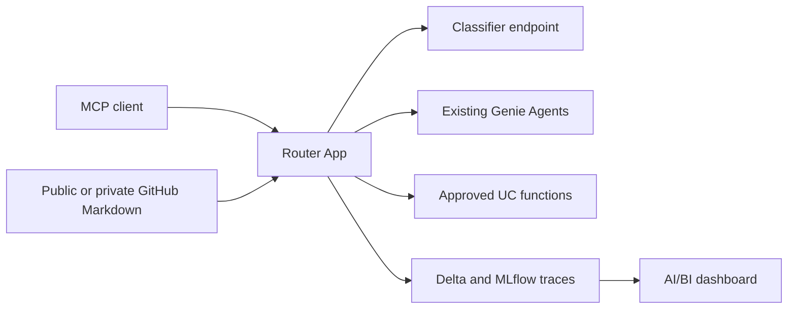

# Genie Routing Reference

Deploy a governed analytics router as a Databricks App. The router exposes one
MCP tool and selects an existing Genie Agent or an allowlisted Unity Catalog
function for each analytics question. Routing evidence is written to Delta and
MLflow and visualized in an AI/BI dashboard.

## Quick start

Clone the repository, configure your existing Databricks resources, and run the
guarded installer:

```bash
git clone https://github.com/omriaf/genie-routing-reference.git
cd genie-routing-reference
cp customer_config/customer.example.yml customer_config/customer.yml
# Configure customer_config/customer.yml with your workspace resources.
./install.sh --profile "<PROFILE>"
```

The installer prepares pinned dependencies, compiles the configuration, runs
metadata preflight and strict DAB validation, and displays a redacted summary.
It asks for confirmation before any workspace write, then bootstraps, deploys,
starts the App and prints the bundle links. Prerequisites are Python 3.11+,
[`uv`](https://docs.astral.sh/uv/), Databricks CLI 1.0+, and an explicitly
configured CLI profile. See [customer installation](docs/INSTALL_CUSTOMER.md)
for prerequisites and post-install smoke tests.

## Architecture

One Databricks App exposes the `ask_analytics(question)` MCP tool. It loads
governed business definitions from public or private GitHub Markdown, classifies each
question once through an existing model serving endpoint, then routes to an
existing Genie Agent or an explicitly approved Unity Catalog table function.
Unrecognized domains and undefined metrics return an explicit refusal. Each
request records routing evidence in Delta and MLflow; an AI/BI dashboard reads
the trace table.



## What you provide and what the DAB creates

| You provide | DAB creates / package initializes |
| --- | --- |
| Explicitly selected CLI profile and deployment authority | Router App and its service principal, resource bindings and optional App readers |
| Existing catalog and Pro or Serverless SQL warehouse | Dedicated router schema and Delta `routing_traces` table through bootstrap SQL |
| Existing classifier serving endpoint | Rerunnable bootstrap job and explicit App traversal grants |
| Existing Genie Agent space IDs, data and execution permissions | AI/BI routing dashboard and optional dashboard readers with trace-table read grants |
| Existing approved UC table functions, or an empty function allowlist | Bundle-managed MLflow experiment and App access to it |
| Markdown repository/branch/folder; for private access, an existing secret scope/key holding a read-only GitHub credential | Compiled runtime configuration and staged App sources |

The DAB references the warehouse, endpoint, Genie Agents, functions, and—when private access is selected—the secret.
It does not create these dependencies. The optional demo supplies synthetic
SQL and Genie import requests; the installer separately seeds its data and
creates its agents. Only demo compilation adds a reseeding job.

## Security boundaries

The installer needs authority to delegate App bindings; the App principal
receives narrower runtime access. Configuration contains resource references
and optional secret scope/key names only. Token values stay in the secret store and
must never enter a chat, YAML, terminal transcript, or commit. Traces include
questions and answers: restrict readers and define retention. Read the
[security and permission model](docs/SECURITY.md) before granting access.

## Choose an installation path in five minutes

| Your starting point | Follow |
| --- | --- |
| Evaluate with synthetic retail, support and marketing data in a dedicated schema | [Demo installation](docs/INSTALL_DEMO.md) |
| Route against your existing Genie Agents, governed definitions and approved functions | [Existing data installation](docs/INSTALL_CUSTOMER.md) |
| Give an assistant the public repository URL and install interactively | [AI-assisted installation](docs/AI_ASSISTED_INSTALL.md), governed by [AGENTS.md](AGENTS.md) |

Five minutes is the decision time; workspace provisioning and approvals take
longer. Both human paths include clone, prerequisites, compile, preflight,
strict validation, deployment approval, and smoke checks. Replace every
`<PLACEHOLDER>` locally before executing an example. Always supply the profile
you selected explicitly as `--profile "<PROFILE>"`; assistants never choose one.
All commands run from the cloned repository root unless a step says otherwise.

The public source checkout needs no private GitHub token. Runtime business
definitions live in a separate public or private repository. Edit deployment settings in
the ignored `customer_config/customer.yml`; demo settings use the ignored
`.generated-demo-setup/demo.yml`. Recompile generated files rather than editing
application or resource code. The [configuration contract](customer_config/README.md)
lists field types and restrictions.

For updates, operation, troubleshooting, rollback and cleanup, use
[Operations](docs/OPERATIONS.md). For offline verification after environment
setup, run:

```bash
python -m pytest tests/test_documentation.py -v
python -m pytest -q
```

Offline tests exercise configuration, routing and generated resource contracts.
Authenticated preflight, strict workspace validation and live smoke checks are
also required before calling an installation ready.

The [verification guide](validation/README.md) includes the local publication
scanner, synthetic production/demo compilation, explicit-profile smoke tooling
and a local clean-clone rehearsal. Keep internal results and test settings in
its ignored paths.
